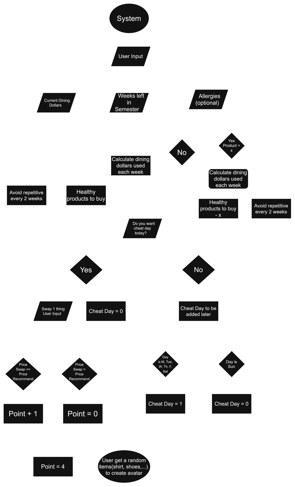

# Dining Dollars Health Optimizer (3rd St. Market)

An application that optimizes campus dining purchases at Third Street Market based on budget pacing, dietary restrictions, and meal variety, complete with a gamified "Cheat Day" avatar reward system.

## The Problem

Campus dining dollars are notoriously difficult to budget evenly through the final weeks of a semester, and finding healthy, allergen-free meal options at campus markets can be challenging. Many students struggle to maintain a balanced diet while staying within their meal plan budget and avoiding repetitive food choices. I built this tool to automate budget tracking, filter out personal food allergens, and keep weekly meal planning both balanced and engaging.

## How It Works

The application processes user inputs, generates optimal meal plans, and manages weekly Cheat Day rewards through the following workflow:

1. **Input Processing & Budget Pacing:** 
   - Accepts current Dining Dollars, remaining semester weeks, and optional allergy preferences.
   - Calculates the allowable weekly spending limit.

2. **Allergen & Variety Optimization:**
   - Filters out allergen products (Product = x).
   - Recommends healthy products while executing a variety constraint (*Avoid repetitive items every 2 weeks*).

3. **Cheat Day & Gamification Logic:**
   - Prompts the user for a weekly Cheat Day swap.
   - If NO: Tracks days remaining before resetting on Sunday (*Cheat day expires at the end of the week*).
   - If YES: Allows swapping 1 item (Cheat Day = 0).
     - If Price Swap <= Price Recommend --> Point + 1
     - If Price Swap > Price Recommend --> Point + 0
   - Accumulating Point = 4 (after a month) unlocks random clothing items (shirts, shoes, etc.) for avatar customization.



## Eisenhower Matrix


## Tech Stack

- **Language:** Python 3.x
- **Libraries:** Built-in modules (json, csv) / Optional data libraries (pandas)
- **External tools:** Git, GitHub, VS Code

## Setup

Step-by-step instructions to get the project running locally:

```bash
git clone [https://github.com/KhanhAn26/dining-dollars-health-optimizer.git](https://github.com/KhanhAn26/dining-dollars-health-optimizer.git)
cd dining-dollars-health-optimizer
# Optional: pip install pandas
```
## Usage

How to actually run the thing, with examples.

```bash
python main.py --dollars 300 --weeks 8 --allergies peanuts,dairy
```
- Python main.py: Executes the Python script
- --dollars 300: Passes the user's current Dining Dollars balance (300) to calculate budget pacing.
- --weeks 8: Specifies the number of weeks left in the semester (8 weeks) for timeline distribution.
- --allergies peanuts, dairy: Provides a comma-separated list of food allergies so the app can automatically exclude those items from recommendations.

## Roadmap

Features you haven't built yet but plan to (pull these from your
"Schedule" quadrant in the Eisenhower Matrix).

- [ ] Interactive HTML/CSS dashboard layout for results display
- [ ] Advanced menu variety tracking algorithm across consecutive weeks
- [ ] Lightweight web interface styling for the item swap and point accumulation tracker

## Author

Nguyen Khanh An Vu, https://github.com/KhanhAn26
