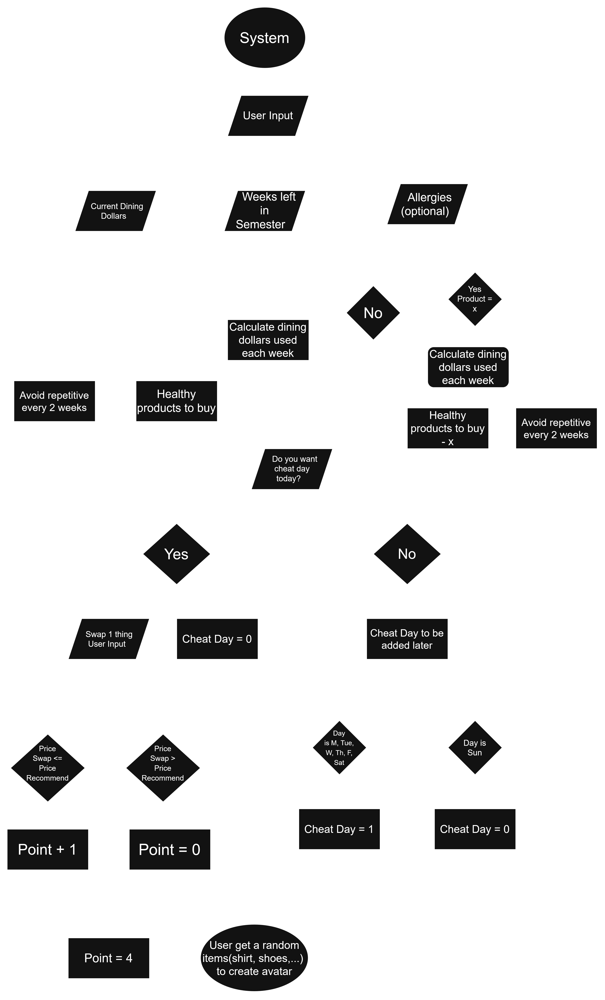
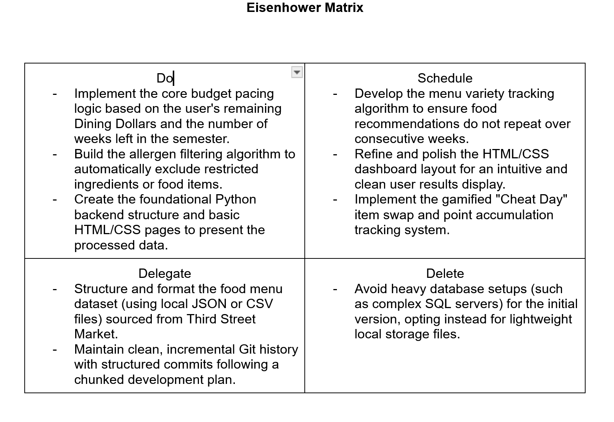

# Dining Dollars Health Optimizer (3rd St. Market)

An application that optimizes campus dining purchases at Third Street Market based on budget pacing, dietary restrictions, and meal variety, complete with a gamified "Cheat Day" avatar reward system.

## The Problem

Campus dining dollars are notoriously difficult to budget evenly through the final weeks of a semester, and finding healthy, allergen-free meal options at campus markets can be challenging. Many students struggle to maintain a balanced diet while staying within their meal plan budget and avoiding repetitive food choices. I built this tool to automate budget tracking, filter out personal food allergens, and keep weekly meal planning both balanced and engaging.

## How It Works

The application processes user inputs, generates optimal meal plans, and manages weekly Cheat Day rewards through the following workflow:

1. **Input Processing & Budget Pacing:** 
   - Accepts current Dining Dollars, remaining semester weeks, and optional allergy preferences.
   - Calculates the allowable weekly spending limit.

2. **Allergen & Variety Optimization:**
   - Filters out allergen products (Product = x).
   - Recommends healthy products while executing a variety constraint (*Avoid repetitive items every 2 weeks*).

3. **Cheat Day & Gamification Logic:**
   - Prompts the user for a weekly Cheat Day swap.
   - If NO: Tracks days remaining before resetting on Sunday (*Cheat day expires at the end of the week*).
   - If YES: Allows swapping 1 item (Cheat Day = 0).
     - If Price Swap <= Price Recommend --> Point + 1
     - If Price Swap > Price Recommend --> Point + 0
   - Accumulating Point = 4 (after a month) unlocks random clothing items (shirts, shoes, etc.) for avatar customization.

## System diagram



## Eisenhower Matrix



## Tech Stack

- **Language:** Python 3.x, HTML, CSS, JavaScript
- **Libraries:** BBuilt-in modules (`argparse`, `csv`, `json`, `pathlib`, `random`), `flask` (for web app)
- **External tools:** Git, GitHub, VS Code
- **Data Storage:** Menu dataset CSV file, local JSON state (`data/state.json`) for CLI, and browser `localStorage` for web UI

## Setup

Step-by-step instructions to get the project running locally:

```bash
git clone [https://github.com/KhanhAn26/dining-dollars-health-optimizer.git](https://github.com/KhanhAn26/dining-dollars-health-optimizer.git)
cd dining-dollars-health-optimizer
pip install flask
```
## Usage
1. Run the CLI (main.py): 
Make sure that the CSV file is in docs.

```bash
py main.py --dollars 167.49 --weeks 4 --allergies peanuts
```
- Python main.py: Executes the Python script
- --dollars 167.49: Passes the user's current Dining Dollars balance (167.49) to calculate budget pacing.
- --weeks 4: Specifies the number of weeks left in the semester (4 weeks) for timeline distribution.
- --allergies peanuts: Provides a comma-separated list of food allergies so the app can automatically exclude those items from recommendations.
- Example output:
  PS C:\Users\Surface\Documents\dining-dollars-health-optimizer> py main.py --dollars 167.49 --weeks 4 --allergies peanuts


=== DINING DOLLARS HEALTH OPTIMIZER ===
Dataset:          C:\Users\Surface\Downloads\Third Street Market Products - Sheet1.csv (53 items)
Dining Dollars:   $167.49 | Remaining Weeks: 4
Weekly Budget:    $41.87
Period Budget:    $41.87 | Selected Total: $40.97 | Left: $0.90
Allergies:        peanuts

--- Recommended Healthy Items (10 items within budget) ---
  1. [ITEM_20] Pasta salad - $7.19 (HEALTHY)
  2. [ITEM_22] Panera soup - $7.25 (HEALTHY)
  3. [ITEM_23] Veggies & ranch - $6.29 (HEALTHY)
  4. [ITEM_24] Cottage cheese - $3.59 (HEALTHY)
  5. [ITEM_26] Almond silk milk - $5.29 (HEALTHY)
  6. [ITEM_27] Chobani drinks - $4.39 (HEALTHY)
  7. [ITEM_28] Yoplait yogurt - $2.49 (HEALTHY)
  8. [ITEM_29] Prairie farm pints - $1.79 (HEALTHY)
  9. [ITEM_41] Blue diamonds almond - $2.19 (HEALTHY)
  10. [ITEM_50] Clementine Single - $0.50 (HEALTHY)

Use Cheat Day swap this week? (y/n): y

--- Pick Healthy Item to Swap Out ---
  1. Pasta salad ($7.19)
  2. Panera soup ($7.25)
  3. Veggies & ranch ($6.29)
  4. Cottage cheese ($3.59)
  5. Almond silk milk ($5.29)
  6. Chobani drinks ($4.39)
  7. Yoplait yogurt ($2.49)
  8. Prairie farm pints ($1.79)
  9. Blue diamonds almond ($2.19)
  10. Clementine Single ($0.50)
Pick healthy item number to swap (or Enter to use avg $4.10): 3
Selected healthy item to swap: Veggies & ranch ($6.29)

--- Cheat Day List (Non-Healthy Treats) ---
  1. Nestle morsels ($8.19)
  2. Hunts SP pudding vani ($4.29)
  3. Stir fry Korean BBQ ($3.09)
  4. Velveeta Cheesy bowl ($7.29)
  5. Mac and cheese ($7.39)
  6. Yakisoba ($3.49)
  7. Annie Chun noodle bowl ($5.99)
  8. Buldak spicy ramen ($5.99)
  9. Sweet banana chip ($5.09)
  10. Blue Bunny ice cream ($4.09)
  11. Pronax Tray ($4.19)
  12. Blount meals ($7.99)
  13. Prairie farm 1/2 gal chocolate ($5.27)
Pick item number to swap (or Enter to skip): 6
Swap accepted: Yakisoba ($3.49 <= $6.29). +1 Point!
Swapped out healthy item: Veggies & ranch ($6.29)

Current Points: 1 | Unlocked Avatar Items: []

2. Run the Web app
```bash
py \.app.py
```
- Open the local address shown in the terminal (for example: http://127.0.0.1:5000) in the browser. 
## Roadmap

- [x] Develop the menu variety tracking algorithm to ensure food recommendations do not repeat over consecutive weeks.  
- [x] Refine and polish the HTML/CSS dashboard layout for an intuitive and clean user results display.
- [x] Implement the gamified "Cheat Day" item swap and point accumulation tracking system.

## Demo

Link to demo video: https://youtu.be/THMQu6hHiV8

## Author

Nguyen Khanh An Vu, https://github.com/KhanhAn26
